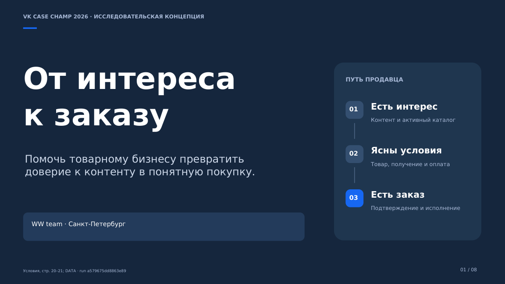

# WW team VK · От интереса к заказу

Исследование социальной коммерции для VK Case Champ 2026, Санкт-Петербург. Все семь листов XLSX за сентябрь 2026 обработаны. Это синтетические данные чемпионата, не реальные показатели компании.

Решение: проверить понятный путь из контента и каталога до внутреннего заказа у готовых товарных продавцов. Маркет — общие торговые компоненты; вклад отдельной главной проверяется отдельным экспериментом.



## Посмотреть результат

- [Презентация PDF](deliverables/WW_team_strategy_spb.pdf) — ровно 8 слайдов.
- [Редактируемая презентация PPTX](deliverables/WW_team_strategy_spb.pptx) — надписи, блоки и схемы редактируются.
- [Исследование PDF](deliverables/research.pdf) и [Markdown](deliverables/research.md) — сценарии, эксперимент и источники.
- [Приложение PDF](deliverables/appendix.pdf) — аудит, тематики, устойчивость, задачи и FAQ.
- [Кандидаты для пилота CSV](deliverables/pilot_candidates.csv) — список для ручной квалификации.
- `outputs/current_run.json` — указатель на завершённый расчёт; его манифест содержит SHA-256 артефактов.

| Участник | Вуз |
|---|---|
| Савватеев Глеб | ГУАП |
| Бочковский Андрей | ГУАП |
| Веселкин Арсений | ГУАП |
| Павлов Арсений | ИТМО |

Состав включён в презентацию и отчёт. Распределение ролей — предложение для согласования командой. Для воспроизводимого обновления измените `config/project.yaml` и пересоберите материалы. Интервью, пилот и A/B-тест ещё предстоит провести.

## Запуск

Команды выполнять из корня проекта. Проверено на Python 3.12.7/macOS arm64. Зависимости закреплены в `uv.lock`. Установка требует сети; после неё анализ, тесты и экспорты работают локально.

```bash
./scripts/setup
.venv/bin/vk-case inspect --input-dir data/raw
./scripts/recalculate
.venv/bin/vk-case verify --latest --output-dir outputs
./scripts/start-app
```

Приложение: `http://127.0.0.1:8501`. Шесть разделов: обзор, качество, бизнесы, Маркет, экономика, концепция с демо. Фильтры бизнесов не меняют агрегаты других контуров. Калькулятор и полный прогон вызывают одни расчётные функции.

Если uv установлен в PATH, эквивалентный маршрут:

```bash
uv sync --locked
uv run vk-case inspect --input-dir data/raw
uv run vk-case run --input-dir data/raw --output-dir outputs
uv run vk-case verify --latest --output-dir outputs
uv run streamlit run app/streamlit_app.py
uv run pytest
uv run ruff check .
```

В подготовленной среде uv находится в `.tools/uv`. `scripts/setup` выбирает установленный uv или локальную копию; в чистой распаковке устанавливает uv в `.bootstrap`, не меняя системный Python.

## Входы и пересчёт

В `data/raw`: побайтовые копии `case.pdf` (36 страниц), `plan.pdf` (25 страниц), `dataset.xlsx` (7 листов) и `brief.md`. Хеши и исходные имена — `input_manifest.json`. Оригиналы в Downloads не изменены.

```bash
.venv/bin/vk-case run --workbook /absolute/path/input.xlsx --config config/project.yaml --output-dir outputs
.venv/bin/vk-case verify --run-dir outputs/runs/RUN_ID
```

Отсутствующий XLSX не подменяется демо. Несколько XLSX требуют явного `--workbook`. Пустая база, неоднозначные заголовки и обязательные пропуски останавливают зависимый расчёт. Ориентиры старого плана не заполняют результаты другой версии данных.

Run ID зависит от хеша XLSX, конфигурации, расчётного кода, содержательных документов, источников и lock-файла. Timestamp отдельно. Числа воспроизводятся; идентичность метаданных PDF не требуется. Публикация результата и обновление `current_run.json` атомарны. Сбой сохраняется в `outputs/failed`; предыдущий успешный указатель остаётся действующим.

В GitHub включены исходные материалы кейса, итоговые документы и один проверенный расчёт. Рабочие окружения, кеши, локальная SQLite, промежуточные и неудачные запуски в репозиторий не входят. Для исходника внутри проекта манифест использует относительный путь, поэтому проверка работает после клонирования.

В `config/project.yaml` редактируются четыре именованных сценария, маржа, затраты, чистая ставка, инвестиции и удержание. N и неокруглённый AOV берутся из текущего XLSX. Старый пример N=966 и AOV=2853 — отдельно в `reference_reproduction.csv`. При неизвестной марже прибыль недоступна. Нулевые затраты и 2% — допущения, не действующий тариф VK и не установленная экономика. Уменьшение стоимости из-за невыполнения и возвратов учитывается однократно.

## Проверки и экспорт

```bash
.venv/bin/pytest -q
.venv/bin/ruff check .
.venv/bin/python scripts/render_pdfs.py
```

Фактические результаты — `docs/qa_summary.md`; рендеры всех страниц — `qa/pdf_preview`. Браузерная проверка шести разделов — `scripts/browser_qa.py`: локальный Chrome и уже работающий сервер. Скриншоты — `qa/browser`.

PDF и PPTX экспортируются полным прогоном из общего позиционированного источника `slides_source.json`. LibreOffice, облачный аккаунт и API-ключ не требуются. Вручную изменённый PPTX не переносится автоматически обратно в расчётный источник. Полный прогон использует исходники в `src/vk_case`; на выходе всегда ровно восемь основных страниц и отдельное приложение.

Основные тесты создают небольшую семилистовую фикстуру без сети и реального XLSX. Реальный прогон и UI проверяются при наличии соответствующего входа/готового расчёта. Тесты экономики и демо не зависят от внешних сайтов.

## Демо без исходных данных

```bash
.venv/bin/vk-case demo
.venv/bin/streamlit run app/streamlit_app.py --server.port 8502 -- --demo
```

Демо использует отдельные товары и SQLite `data/demo/runtime.sqlite`; все записи имеют `is_demo`, анализ её не читает. Повторное подтверждение не создаёт второй заказ. Онлайн-оплата и оплата при получении имеют разные переходы; заказной товар требует согласования; еда — доступной зоны. Внешний переход не создаёт заказ. Сброс — явным действием в интерфейсе. `VK_CASE_DEMO_STORE` задаёт отдельную SQLite для тестирования.

## Документы

- `docs/strategy.md` — пять ответов, альтернативы, паспорта инструментов и пути.
- `docs/methodology.md`, `data_dictionary.md` — определения, формулы и границы расчёта.
- `docs/experiment_plan.md` — события, ITT, мощность и правила остановки.
- `research/sources.csv`, `competitor_matrix.csv`, `claims.csv` — основания и статусы проверки.
- `research/interview_guide.md` — исследования, которые ещё не проведены.
- `docs/team_workplan.md` — задачи, сроки, зависимости, проверяющие и FAQ.
- `docs/status.md`, `limitations.md`, `qa_summary.md` — состояние и неизвестные.

Внешние источники проверены 17.11.2026; состав команды и материалы обновлены 18.11.2026. Рынок даёт контекст; его объём не используется для экстраполяции выборки. Применение ИИ раскрыто в отчёте, презентации и FAQ. Репозиторий: [Arsenyyya/WW-team-VK](https://github.com/Arsenyyya/WW-team-VK). Сдача через форму чемпионата не выполнялась.
